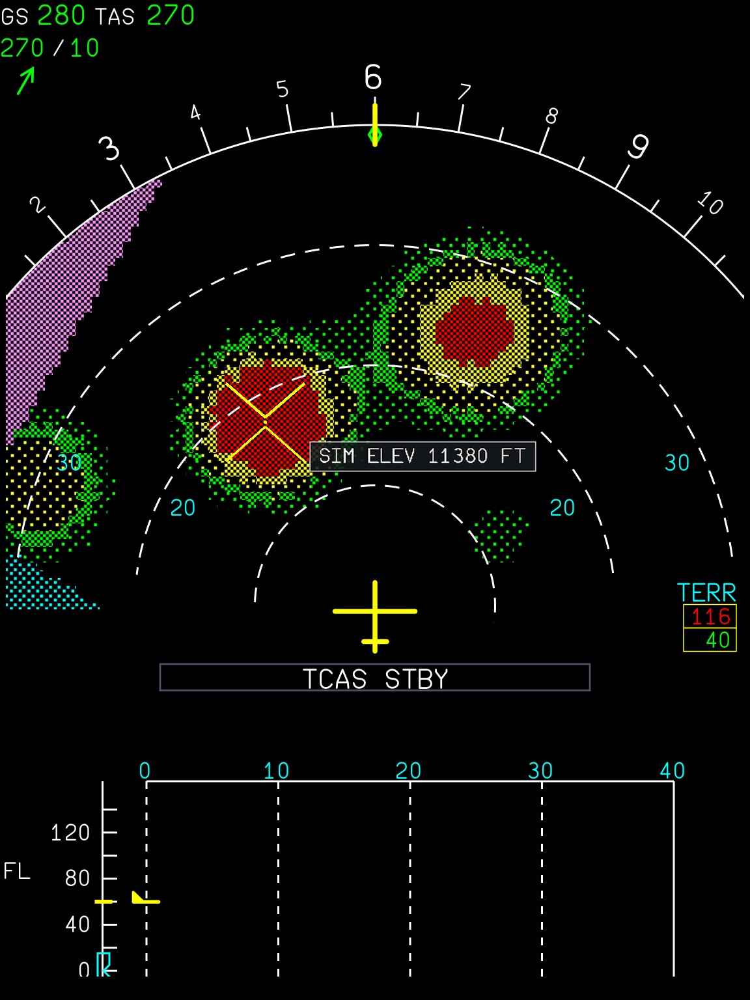

# TERRAIN on ND

The two NDs show the A380 TAWS terrain display (EGPWS-style colours relative to the aircraft, peaks
mode when well above the terrain, the TERR box with the highest/lowest elevation) built from X-Plane's
own scenery with terrain probes, plus a **simulator aid**: the elevation of the terrain under the ND
pointer, and **TAWS look-ahead terrain alerts** (caution / warning, see "Terrain alerts"). Status: built and tested off-simulator (mock XPLM, the real display helper); **not yet run in
X-Plane** (see "Verify in X-Plane").

## Using it

- Press **TERR** on the EFIS control panel (the existing pushbutton, command
  `a380x/xp12/efis/{captain,first_officer}/terr_toggle`, lamp `a380x/xp12/efis/<side>/terr`). On the
  A380 TERR and WX select the ND's single surveillance overlay: TERR replaces WX and the other way
  round, pressing the selected one clears it (FlyByWire `A380FcuComputer` `pSurvFilter` NONE/WX/TERR).
  No cockpit object was changed; no new command was needed.
- Terrain is shown in ARC and in ROSE LS/VOR/NAV, not in PLAN and not at the ZOOM (OANS) range
  (FlyByWire `EfisTawsBridge`: `terrOnNd = mode != PLAN && overlay == TERR && !terrFailed && ndAvail`).
  It also needs the ND unit on, ADIRS position and heading valid, the SURV panel WXR/TAWS SYS 1 or 2 and
  TERR SYS not OFF. With WXR/TAWS SYS OFF or no terrain probe the FBW ND shows its own **TERR INOP**;
  TERR SYS OFF shows FBW's **NO TERR AND WX DATA AVAILABLE** (both in the vertical display area).
- The picture is refreshed like the A380 display (FlyByWire SimBridge "scan-line" mode): a new frame
  every 1.1 s, revealed from the bottom of the map upwards over 0.6 s. Between sweeps the image keeps
  the position and heading it was made for, so in a turn it trails the symbols by up to one sweep.
- **Pointer elevation (simulator aid, not an A380 indication):** move the mouse over an ND's terrain
  area; a grey box beside the cursor reads `SIM ELEV 11380 FT` (one direct probe at that point, 10 ft
  steps), `SIM ELEV 0 FT SEA`, or `SIM ELEV NO DATA` where X-Plane has no scenery loaded. Shown only while
  that ND shows terrain. It is drawn by the plugin over the ND, like the yellow cursor.

| Colour (FBW pattern)              | Normal mode (relative to the aircraft)                      | Peaks mode (aircraft > 500 ft, gear down 250 ft, above all terrain in view) |
|-----------------------------------|-------------------------------------------------------------|------------------------------------------|
| red, high density (50 %)          | more than 2000 ft above                                      | -                                        |
| yellow, high density              | 1000 to 2000 ft above                                        | -                                        |
| yellow, low density (10.7 %)      | 500 ft (gear down 250 ft) below to 1000 ft above            | -                                        |
| green, high density               | 500 (250) to 1000 ft below                                   | middle band: from min(95th percentile, 65 % of the range) |
| green, low density                | 1000 to 2000 ft below                                        | lower band: from min(85th percentile, half the highest)   |
| green, solid                      | -                                                            | highest band: top 5 % of the elevation range              |
| cyan, low density (22 %)          | sea (X-Plane water, below 50 ft)                            | same                                      |
| magenta, high density             | no data: X-Plane has no scenery loaded there (probe missed) | same                                      |
| black                             | more than 2000 ft below, or below the runway cut-off        | below the lower band                      |
| solid yellow / solid red          | TAWS caution / warning threat areas: **not generated** (no TAWS alerting in this port) | - |

Descending faster than 1000 ft/min lowers the reference altitude by half the vertical speed (30 s of
look-ahead). Terrain within 400 ft of the nearest airport's elevation is black (200 ft within 1 NM, ramped
from 4 NM on a glide flatter than 3 degrees). TERR box: highest elevation over the bottom of the lowest
band, in hundreds of feet; the highest is red when it is in the red band, otherwise yellow (normal mode)
or green (peaks); the lowest is yellow when the green bands are squeezed out, otherwise green. The box is
hidden while no terrain is in view.

Sources of these rules: Honeywell MK V/MK VII EGPWS Pilot's Guide 060-4241-000 Rev H (TAD colour table,
peaks display, sea level, magenta unknown terrain, runway cut-off, 30 s descent bias, pop-up option);
FlyByWire SimBridge (exact thresholds, percentiles, TERR box modes, A380 patterns and sweep); FlyByWire
A380X ND bundle (`TerrainMapThresholds`, `EgpwcBusPublisher`, `AesuBusPublisher`, clip paths).

Previews in `docs/nd-terrain-previews/`: `web-*` are frames of the real `A380XDisplayHost` (WebKit, the
FBW ND page with this layer) fed with states made by the plugin's own code from a synthetic world
(mountains, a lake, sea to the west, no scenery north of 45.55 N); the pointer readout and the yellow
cursor in the two `*-pointer` images are the plugin's native overlay composited for review (in X-Plane
they are drawn by the plugin over the device). `native-*` are the native renderer's terrain layer, TERR
box and readout drawn by the production GL code into a software rasterizer.

## How it works

`native/avionics/a380x_terrain.h` (XPLM-free core), `a380x_terrain_adapter.inc` (X-Plane boundary),
`a380x_terrain_render.inc` (native drawing), `a380x_xpkit_terrain.inc` (web state),
`xp-kit-nd/terrain-layer.js` (web layer), `tools/patch_xp_kit_nd.py` (page patch).

1. **Elevation cache.** One latitude/longitude grid of 192 x 192 nodes per selected range (node spacing =
   range / 62.5 NM = 8 ND pixels: 0.16 NM at 10 NM, 0.64 NM at 40 NM, 10.24 NM at 640 NM); both NDs share
   a range's grid; at most three grids (184 KB each). The grid follows the aircraft by integer shifts
   (keeps every sample still inside) and is rebuilt after a jump of more than half its size or 3 degrees
   of latitude. Each node is one `XPLMProbeTerrainXYZ` at `XPLMWorldToLocal(lat, lon)`, converted back with
   `XPLMLocalToWorld` to feet MSL; for spacings above 0.7 NM four probes at +-1/4 spacing, keeping the
   highest. `is_wet` below 50 ft is sea; a wet surface higher up (a lake) is terrain at that height. A
   probe that misses is "no data" and is tried again after 15 s (scenery loads as you fly).
2. **Probe scheduling.** Nearest first from the aircraft, the half-plane ahead first (pass 0), then the
   rest (pass 1), within 70 nodes; restarts just inside the reached frontier when the aircraft moves a
   node, from the centre after a heading change of more than 30 degrees, and every 10 s once finished.
3. **Frame budget.** `terrain_update` runs once per flight loop: the two displays (at most 2048 raster
   cells each) and the pointer probe first, then probing with what is left of 0.5 ms (at most 0.4 ms, 512
   nodes). The clock is read before every node, so a frame overruns by at most one node (1 or 4 probes).
4. **Raster and sweep.** Per ND an 8 x 8 px cell raster of the FBW A380 terrain image (ARC 95 x 63 cells
   from (6, 128), aircraft at (384, 626), 498 px = range; ROSE 85 x 32 cells from (45, 128), aircraft at
   (384, 384), 250 px = range / 2; FBW `arc-mode-wx-terr-clip` / `rose-mode-wx-terr-clip`). A cell takes the
   highest of the four surrounding nodes (FBW takes the highest of an 8 x 8 pixel patch); a missing node
   makes it "no data". Positions use exact great-circle points every 4 cells, interpolated between. The
   histogram (100 ft bins from -500 ft), bands, classes and TERR box follow FBW SimBridge.
5. **Web NDs (macOS WebKit, Windows WebView2 host).** The state JSON gains
   `"terrain":{"sys","terrOff","failed","overlay":[c,f],"nd":[{on,rev,mode,range,x0,y0,cols,rows,min,minMode,max,maxMode,peaks,overflow,cells}]}`,
   `cells` a run-length string (class letter + count). The shared-memory protocol (v9) is unchanged.
   `terrain-layer.js` (after `native-bridge.js`) draws it on a canvas inserted as the first child of the ND
   map container (under every FBW SVG/canvas symbol) at the capture scale, clipped by FBW's paths, with
   FBW's dot tiles anchored at the image origin; it sets the bundle's `L:A32NX_EGPWC_ND_<L|R>_TERRAIN_*`,
   `L:A32NX_WXR_TAWS_SYS_SELECTED`, `L:A32NX_GPWS_TERR_OFF`, `L:A32NX_TERR_<n>_FAILED`,
   `L:A380X_EFIS_<L|R>_ACTIVE_OVERLAY` (and `L:A32NX_WXR_<n>_FAILED` = 1: there is no weather radar, so a
   selected WX shows FBW's WXR INOP), and makes the helper capture when the raster revision changes.
   `package_nd` inlines the layer in a full ND build; for the reused verified page
   (`--xpkit-assets`) `reuse_verified_assets` inserts it with `tools/patch_xp_kit_nd.py` (known page hash,
   exact anchor, idempotent, refreshes an older layer) and records `nd_terrain_patch` and the new
   `nd.html` hash in the display manifest. The tool inserts an ordered list of layers (`LAYERS`): this one,
   then the FMGC pseudo-waypoint layer `fmgc-pwp-layer.js` (AUTOPILOT_DEVELOPMENT.md); the record lists
   each layer's hash.
6. **Native NDs** (no web renderer: Windows without the WebView2 host, or a build without xp-kit): the
   same raster as one RGBA texture per ND (only changed rows re-uploaded), one quad under the map layers of
   `draw_nd` / `draw_nd_fbw`; the FBW TERR box on the 768 x 1024 layout, `TERR <max>/<min>` in the 180 x 234
   layout's status line.
7. **Pointer readout** (`nd_data.terrain_pointer`): the cursor position over the ND device
   (`XPLMIsCursorOverAvionics`) -> the terrain point for the live position and heading -> one probe when
   it moved (at most every 0.15 s; refreshed every 0.5 s) -> drawn after the cursor on the xp-kit ND
   device and on the native ND device. Pointer moves only redraw the device, never capture the web page.

Diagnostics (read-only datarefs): `a380x/xp12/terrain/probe_us` (average time per probe in the budgeted
loop), `frame_us`, `frame_us_max` (last 5 s), `probes_per_frame`, `probes_total`, `hits_total`,
`misses_total`, `captain_active`, `first_officer_active`, `captain_coverage`, `first_officer_coverage`
(cells in view with data), `captain_pointer_elevation_ft`, `first_officer_pointer_elevation_ft` (-9999
when none), `cache_kb`; TAWS: `taws_caution`, `taws_warning`, `taws_phase` (0 en route, 1 terminal,
2 approach, 3 departure), `taws_inhibit` (0 active, 1 off/no data, 2 ground, 3 low, 4 slow),
`taws_min_clearance_ft` (lowest predicted clearance over the terrain in the caution ribbon, 99999 when
inactive), `taws_time_to_conflict_s` (-1 none), `taws_required_clearance_ft`, `taws_lookahead_nm`,
`taws_eval_us`.

## Terrain alerts (TAWS look-ahead)

Forward-looking terrain alerting in the manner of the EGPWS "Terrain Look Ahead Alerting" (Honeywell MK
V/MK VII Pilot's Guide 060-4241-000 Rev H) with the required terrain clearances of EASA CS ACNS.E.TAWS.015
/ FAA TSO-C151. It is a model of the published behaviour, not Honeywell's algorithm. Core:
`native/avionics/a380x_taws.h` (XPLM-free, `test_taws.c`); adapter: `a380x_terrain_adapter.inc`.

- **Terrain data**: a dedicated 10 NM level of the elevation cache (0.16 NM nodes, probed out to about
  11 NM, ahead first), kept whenever TAWS is available and the position valid, whether or not an ND shows
  terrain (an ND at 10 NM shares it). It is first in the probing round robin within the same 0.4 ms
  budget. Water counts as sea level; no data never alerts.
- **Predicted path** (5 evaluations per second): from the position along the true track at the ground
  speed, turning at the current track rate (at most 90 degrees), and climbing or descending at the
  current inertial vertical speed (a climb counts at 80 %); X-Plane's geometric altitude (the EGPWS uses
  GPS altitude, so QNH errors do not matter). Two ribbons along it, 1/4 NM wide at the aircraft and
  splayed 3 degrees each side (plus up to 7 degrees more when turning).
- **Caution** when terrain in the ribbon is higher than the predicted altitude minus the required
  clearance within 60 s of flight (at most 8 NM); **warning** within 30 s. Required clearance: en route
  700 ft level / 500 ft climbing or descending (> 500 fpm), terminal (within 15 NM of the nearest
  airport) 350 / 300, approach (within 5 NM) 150 / 100, linear in between; departure (3 min after
  lift-off) 100 ft.
- **Near the runway**: terrain within 2.5 NM of the nearest airport and less than 150 ft above its
  elevation is the runway environment and never alerts; in the approach phase, descending towards the
  airport (its reference point ahead of the aircraft), the look-ahead ends 0.5 NM past that point, so
  the path continued below the runway never alerts on terrain beyond it; once the airport is behind
  (overflight, go-around) the full look-ahead applies again. Airport = nearest of the ND navaid cache,
  elevation probed.
- **Hysteresis**: an alert starts after conflicts in two consecutive evaluations (0.4 s) and ends 2 s
  after the last conflict.
- **Inhibits**: WXR/TAWS SYS OFF, TERR SYS OFF, no terrain probe or no valid position; on the ground;
  below 30 ft radio altitude; below 50 kt ground speed; on departure below 400 ft above the airport.
  GPWS SYS OFF inhibits the basic GPWS modes (1/2) only, as on the A380 (FCOM: TERR SYS OFF inhibits the
  terrain functions, GPWS SYS OFF the basic modes).
- **Outputs**: both NDs paint the terrain that caused the alert (each conflict point's cell and the
  eight around it) **solid yellow** (caution) or **solid red** (warning), within the normal sweep; the
  start of an alert selects TERR on both EFIS CPs (pop-up, replacing WX) if it was not selected; the PFD
  shows **PULL UP** (red, warning, also GPWS modes 1/2) or **TERRAIN** (amber, caution) at the FBW
  warning position (FBW PFD: `L:A32NX_EGPWS_ALERT_1_DISCRETE_WORD_1` bits 12/13, published for index 1
  and 2; native PFD the same texts, below STALL); aurals: the PULL UP loop for the warning and an
  optional "TERRAIN AHEAD" sample for the caution (`docs/COCKPIT_AURALS.md`). There is no ECAM message
  for TAWS alerts on the A380, so none was added.
- **Blinking PFD warnings in the display helper**: FBW's PFD blinks these texts with a CSS animation
  (`Blink9Seconds`, 1 Hz for 9 s, starting transparent). The offscreen helper suspends the page's
  animation timeline, so they would never become visible (measured with the real helper: no PULL UP at
  all). `native/avionics/xp-kit/animation-clock.js` advances suspended CSS animations on the helper's
  native frame clock; `tools/patch_xp_kit_pfd.py` inserts it after the bridge of the verified installed
  `pfd.html` (anchored, idempotent, hash-checked, like the ND terrain patch) and a full PFD package
  inlines it. With it the real helper shows PULL UP blinking 1 Hz for 9 s, then steady, as FBW does. It
  also makes the PFD's other FBW blinking texts work; nothing else of the page changes.

Behaviour checked off-simulator (`test_taws`, synthetic terrain, 50 Hz flight, 5 Hz evaluation):

| Case | Result |
|---|---|
| Level 5000 ft at 250 kt towards a 6000 ft ridge | caution 59.6 s, warning 29.6 s before it |
| Same at 480 kt (8 NM look-ahead cap) | caution 59.8 s, warning 29.8 s |
| 1500 ft above the ridge / 500 ft above | none / caution and warning (clearance < 700 ft) |
| Climbing 1500 fpm towards it / level at the same height | none / alert |
| Descending 2500 fpm towards a plateau | caution after 25.6 s, warning after 55.6 s of flight |
| Valley, straight / turning 3 deg/s into its wall | none (min clearance 1500 ft) / caution after 0.4 s |
| 3-degree approach to 50 ft, a 600 ft hill 1 NM beside final | none (min clearance 474 ft) |
| Same approach 1100 ft low | caution, then warning |
| Same approach, a 600 ft hill 0.5 NM past the far runway end | none |
| Descending overflight of the airport towards a ridge 4 NM beyond | caution 64.8 s before the ridge |
| Departure climbing 2000 fpm towards 2500 ft hills | none |
| Ground, TAWS off, RA < 30 ft, < 50 kt, missing data, sea | none |
| Cost at 500 kt | 624 terrain samples, about 10 us per evaluation (5 per second) |

Through the adapter (`test_terrain_adapter`, the synthetic mountain world, 300 kt): no alert 2300 ft
above an 11,700 ft summit; caution at 9500 ft (conflict 36.5 s ahead) with 45 solid yellow cells on
each ND (ARC 20 NM) and TERR popped up on both (WX deselected); warning at 8000 ft (23 s ahead), 24 red
+ 40 yellow cells; alerts end 2 s after climbing away; all inhibits; PFD words 2048 / 4096. The JS layer
check draws the warning state's classes 9/10 solid and decodes the EGPWS word through the real bridge.

Known limits: the predicted path keeps the current vertical speed, so a descent towards a level-off
just above high terrain can give a caution before the level-off (a real EGPWS behaves similarly; it does
not know the selected altitude either). The terrain is the X-Plane mesh, without obstacles. The runway
logic uses the nearest airport reference point and its probed elevation, not runway thresholds.

## Measured (off-simulator)

All in `native/avionics/build.py` (results in `build-report.json` `nd_terrain`):

- Budget, simulated probe cost 1 / 5 / 20 / 100 us: 400 / 80 / 20 / 4 probes per frame, frame 400 us;
  real-time busy-waiting 5 us probe: worst probing frame 404 us; scheduler + cache store 0.1-0.2 us per node.
- Whole adapter (`test_terrain_adapter`, 5 us probes, 50 Hz, ARC 40 NM): forward area fully covered
  within 5 s (15,373 probes), worst `terrain_update` 483-505 us including the display builds.
- Raster: a whole ARC frame (lattice, 5985 cells, classes, box) 170-315 us when done at once; built over
  three frames of 2048 cells.
- Web state: about 1.4 KB per ND for the synthetic ARC 40 NM scene (run-length string 0.5-1.2 KB).
- Real helper, worst case (raster replaced at 25 Hz during 0.6 s of every 1.1 s, heading turning
  6 deg/s): ND capture 15.8 -> 16.2-16.7 ms, ND capture rate about 5 % lower (40.2 -> 38.3 and 37.9 ->
  36.0 fps), apply time unchanged; PFDs unchanged. Repeated runs without terrain differ by 2-3 fps.
- `tools/validate_aircraft.py` passes with this build overlaid (provider manifest updated as an install
  would; same two warnings as the unmodified aircraft).

## Verify in X-Plane

Only the simulator can show: the real cost of `XPLMProbeTerrainXYZ` (watch `probe_us`, `frame_us_max`);
how far X-Plane 12 has scenery loaded (beyond it the display is magenta, so at 160-640 NM a large part
of the ND can be magenta, where a real EGPWS would draw its database) - and whether probes there really
miss rather than hit a flat placeholder surface; whether the probed mesh, `is_wet` and the airport
elevations behave as assumed; the cockpit TERR key/lamp; the readout's legibility in the
3D cockpit; the Windows plugin at runtime (it is only cross-compiled and unit-tested here).

TAWS alerts, to check in flight: fly level at 2000-3000 ft above ground towards rising terrain (for
example out of a valley towards a ridge) and watch `a380x/xp12/terrain/taws_time_to_conflict_s`,
`taws_min_clearance_ft`, `taws_caution` / `taws_warning`: the caution about 60 s and the warning about
30 s before the terrain, the solid areas and the TERR pop-up on both NDs, PULL UP / TERRAIN on the PFDs
and the PULL UP loop; that normal approaches and departures at mountain airports (e.g. Innsbruck LOWI,
Queenstown NZQN) give no nuisance alerts; the probe cost with the extra level (`probe_us`,
`frame_us_max`); the alert inhibits with TERR SYS OFF.

## Not done / differences

- TAWS alerting is the look-ahead model above; not modelled: the terrain clearance floor and premature
  descent alert, obstacles, the "TERRAIN TERRAIN" / "OBSTACLE" voice variants, GPWS modes 3-5 and the
  TERR STBY / TERR FAULT logic. No "TERRAIN AHEAD" recording is supplied (optional sample).
- Data are X-Plane's scenery mesh, not a terrain database: no obstacles; at 80 NM and above each node is
  the highest of four point probes, so narrow peaks between them can be missed (a database cell keeps its
  maximum).
- The runway cut-off uses the nearest airport of the ND's navaid cache and its probed elevation
  (Honeywell: nearest runway). FlyByWire applies it to the destination only and in absolute feet.
- The box is hidden when no land is in view (FlyByWire would show values derived from an empty
  histogram).
- The web vertical display has no terrain profile (FlyByWire draws it from SimBridge); the native
  FBW-layout ND keeps its own VD profile.
- ROSE shows terrain ahead of the aircraft only, as FlyByWire's A380 clip path does.

## Provenance

Ported (GPL-3.0) from FlyByWire SimBridge `flybywiresim/simbridge@f5932323e2f21dd44a5fcfa3e3aab0cdb35b2f36`,
`apps/server/src/terrain/processing/{gpu/rendering/navigationdisplay.ts, navigationdisplayrenderer.ts,
gpu/patterns/scanlinemode.ts, generic/constants.ts}` (the A380 dot pattern map is reproduced as the three
periodic tiles it consists of, checked pixel for pixel). Behaviour references from
`flybywiresim/aircraft@2b2612f9e374bd5c280bbd57369da05f19b2f195`: `fbw-common/.../ND/TerrainMapThresholds.tsx`,
`fbw-a380x/src/wasm/fbw_a380/src/model/A380FcuComputer.cpp`, `fbw-a380x/src/systems/systems-host/Misc/EfisTawsBridge.ts`,
`fbw-common/src/wasm/terronnd`. Colour meanings: Honeywell 060-4241-000 Rev H. No Honeywell, Airbus or
FlyByWire terrain data is included.
